<!-- ===================== CABECERA ===================== -->
<p align="center">
  
</p>

<p align="center">
  <a href="https://github.com/FranciscoFerreiraT">
    
  </a>
</p>

<p align="center">
  <a href="mailto:FranciscoFerreiraTe@gmail.com"></a>
  <a href="https://www.linkedin.com/in/francisco-jose-ferreira-temperan-297b50225/"></a>
  
</p>

---

## 🌟 Sobre mí

```csharp
public class Fran
{
    public string Nombre    => "Francisco José Ferreira Temperán";
    public string Ubicacion => "Vigo, Galicia 🇪🇸";
    public string Trabajo   => "Desarrollador ERP @ Asysgon";

    public string[] DiaADia => new[]
    {
        "Procedimientos almacenados y optimización en SQL Server",
        "Scripting en C# y herramientas .NET a medida",
        "Integración de hardware: balanzas, datáfonos, impresoras",
        "Soporte técnico y administración de sistemas Windows"
    };

    public string Cafe => "Siempre ☕";
}
```

<details>
<summary><b>🎓 Formación</b> (haz clic para desplegar)</summary>
<br>

| Titulación | Centro |
|---|---|
| 🖥️ **CS Desarrollo de Aplicaciones Multiplataforma** (DAM) | CFP Daniel Castelao |
| 🌐 **CS Administración de Sistemas Informáticos en Red** (ASIR) | CFP Daniel Castelao |
| 🔧 **CM Sistemas Microinformáticos y Redes** (SMR) | CFP Montecastelo |

</details>

<details>
<summary><b>🧭 Qué hago</b> (haz clic para desplegar)</summary>
<br>

<table align="center">
  <tr>
    <td align="center" width="33%">
      <h3>🗃️ Bases de datos</h3>
      Procedimientos almacenados<br>
      Optimización de índices<br>
      Informes
    </td>
    <td align="center" width="33%">
      <h3>💻 C# / .NET</h3>
      Servicios de Windows<br>
      Apps WinForms<br>
      Herramientas internas
    </td>
    <td align="center" width="33%">
      <h3>⚙️ Hardware</h3>
      Balanzas<br>
      Datáfonos<br>
      Impresoras
    </td>
  </tr>
  <tr>
    <td align="center">
      <h3>🎮 Videojuegos</h3>
      Godot .NET<br>
      Juegos 2D
    </td>
    <td align="center">
      <h3>🌕 Lua</h3>
      Addons de juegos<br>
      Plugins
    </td>
    <td align="center">
      <h3>🌐 Webs</h3>
      JavaScript<br>
      Firebase
    </td>
  </tr>
</table>

</details>

---

## 🛠️ Tecnologías

<p align="center">
  
  <br><br>
  
</p>

<p align="center">
  
  
  
  
</p>

<h3 align="center">🤖 IA en mi día a día</h3>

<p align="center">
  
  
  
  
</p>

<details>
<summary><b>📈 Lo que estoy aprendiendo ahora</b></summary>
<br>

- [x] SQL Server — procedimientos, optimización e índices
- [x] C# y .NET — servicios de Windows y aplicaciones de escritorio
- [ ] IA agéntica — agentes que automatizan tareas de mi día a día y de desarrollo
- [ ] Lua — addons y plugins para videojuegos
- [ ] Godot .NET — videojuegos 2D

</details>

---

## 📊 Estadísticas de GitHub


<p align="center">
  
  
</p>

---

## 🐍

<p align="center">
  <picture>
    <source media="(prefers-color-scheme: dark)" srcset="https://raw.githubusercontent.com/FranciscoFerreiraT/FranciscoFerreiraT/output/github-snake-dark.svg" />
    <source media="(prefers-color-scheme: light)" srcset="https://raw.githubusercontent.com/FranciscoFerreiraT/FranciscoFerreiraT/output/github-snake.svg" />
    
  </picture>
</p>

---


